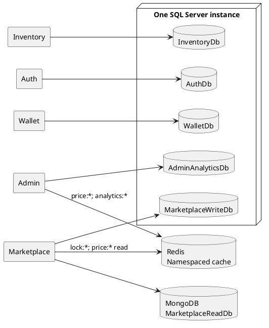
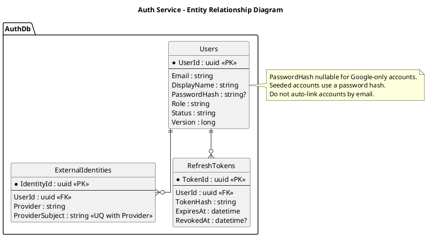
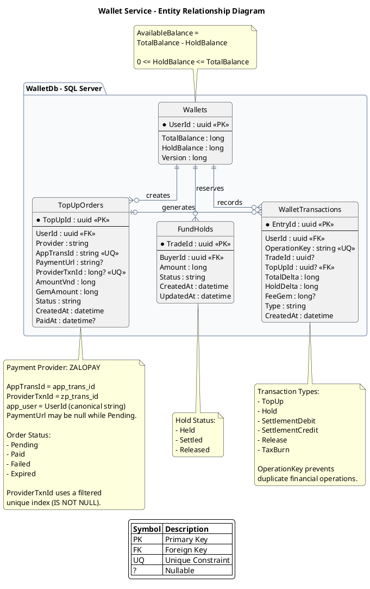
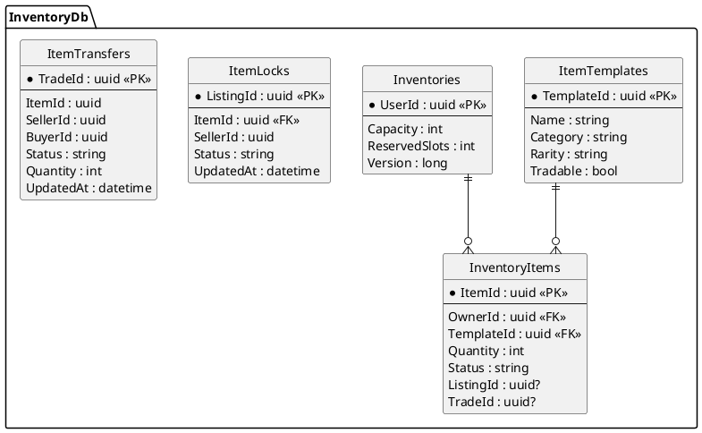
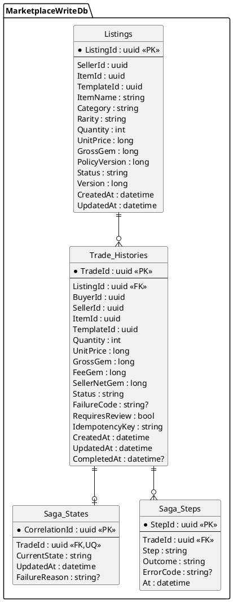
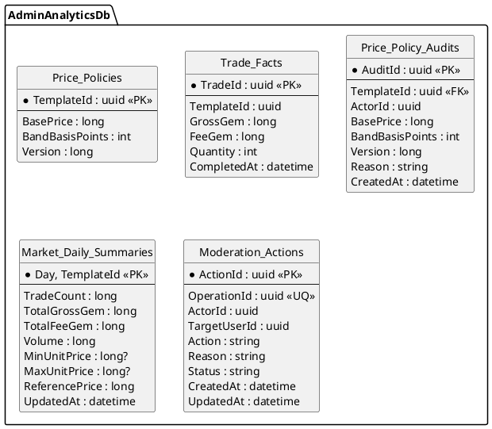
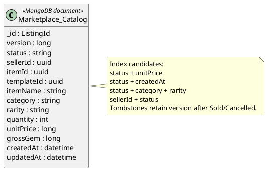

# Database Design
**MVP v0.1 — Logical ERD, chưa phải migration**

## 1. Database-per-Service
Theo `a(1).txt` mục 4: một SQL Server container, 5 logical DB với connection string riêng và MongoDB cho catalog. Service chỉ truy cập DB sở hữu; không join/FK xuyên DB. ID ở service khác chỉ là external reference. Tạo credential riêng theo DB nếu khả thi; không dùng tài khoản sa cho toàn bộ runtime.

## 2. Ownership
| Data | Source of truth | Read copy / access |
|---|---|---|
| Role, account status | AuthDb | JWT claims + status API |
| Gem balance, hold, ledger, top-up | WalletDb | Wallet REST |
| Item, ownership, reservation, capacity | InventoryDb | Catalog snapshot / internal REST |
| Listing, trade history, saga steps | MarketplaceWriteDb | Mongo catalog projection / trade status REST |
| Base price, band, stats | AdminAnalyticsDb | Redis snapshot và aggregates |
| Cache/locks | Redis | Không là nguồn chuẩn của tiền, kho, listing |

## 3. Logical ERDs
Các tên bảng/field dưới đây là đề xuất. UUID/long/datetime là kiểu logic, sẽ map sang SQL Server/EF Core. Các khóa ngoại chỉ ở trong sơ đồ DB sở hữu.

### AuthDb

### WalletDb

### InventoryDb

### MarketplaceWriteDb

### AdminAnalyticsDb

## 4. MongoDB read model
Chỉ lưu dữ liệu đã làm phẳng từ Listing events; không có FK. Query chỉ hiển thị Active. Duy trì version và tombstone Sold/Cancelled để message cũ không làm sống lại tin đã bán/hủy; upsert điều kiện version mới hơn. Index tùy truy vấn và kết quả đo.

## 5. Constraints and transactions
| Store | Ràng buộc quan trọng |
|---|---|
| AuthDb | unique (Provider, ProviderSubject), hash refresh token, nullable PasswordHash cho Google-only, DisplayName theo DTO User; login seed cần email lookup nhất quán |
| WalletDb | CHECK TotalBalance ≥ HoldBalance ≥ 0; unique hold TradeId; unique OperationKey cho ledger; unique AppTransId; unique (Provider, ProviderTxnId) khi có; PaymentUrl nullable; top-up chuyển Pending → Paid một lần |
| InventoryDb | một item instance hoặc khóa toàn stack theo ListingId; capacity check/chuyển đồ trong transaction; unique TradeId transfer; giữ slot seller cho khả năng reverse |
| MarketplaceWriteDb | conditional update WHERE status=Active; idempotency key unique theo buyer + operation; filtered unique completed trade/ListingId nếu cần; TradeId/CorrelationId duy nhất; giữ version tăng dần |
| AdminAnalyticsDb | unique TradeId ở Trade_Facts; daily summary upsert bằng (Day,TemplateId); ghi policy bền vững trước khi publish/cache |

Wallet settlement cập nhật hai ví, trạng thái hold và ledger cùng transaction; không trừ toàn bộ HoldBalance của buyer nếu còn trade khác. Phần fee được ghi rõ trong trade và ledger metadata (không credit ví hệ thống). Inventory transfer/finalize/reverse là mỗi local transaction riêng. Không giữ SQL transaction mở trong lúc chờ HTTP/broker.

## 6. Outbox / Inbox và lưu vết
Các ERD nghiệp vụ trên không vẽ bảng hạ tầng lặp lại: service phát message có OutboxMessages (MessageId, Payload, OccurredAt, PublishedAt...) và consumer có Inbox/ProcessedMessages (Consumer, MessageId, ProcessedAt...). Tên thực tế tùy cơ chế MassTransit đã chọn. Trong cùng transaction, lưu business state + outbox; dispatcher publish retry. Consumer dedupe message ID và khóa nghiệp vụ (TradeId/ListingId) vì retry có thể dùng MessageId khác. Với Mongo projection, version guard; với Redis aggregate, không coi một thao tác increment đơn lẻ là đủ chống trùng.

HTTP Idempotency: mỗi service có mutation dùng Idempotency-Key cần lưu key, actor/operation/resource scope, request fingerprint và resource/result reference bền vững trong cùng local transaction với business intent. Unique theo actor + operation + scope + key; replay khác fingerprint trả 409. Đây là logical infrastructure design, chưa chốt tên bảng/migration. Các field snapshot của listing/trade (policy version, fee/net, quantity), moderation operation id và seller slot reservation phải được map trước khi migration theo Contracts mục 08/11; ERD nghiệp vụ hiện tại không vẽ toàn bộ field kỹ thuật.

## 7. Redis namespaces
| Key | Owner | TTL / semantics |
|---|---|---|
| lock:listing:{id} | Marketplace | 10–30s, unique token; compare-and-delete; SQL status là bảo vệ cuối |
| price:policy:{templateId} | Admin write; Marketplace read-only | versioned snapshot {referencePrice, band, version}; cache miss gọi nội bộ Admin (`ADM-I01`); không mặc định giá 0 |
| analytics:{day}:{templateId} | Admin | thống kê tái tạo từ Trade_Facts; giữ đủ thời gian đối soát |

Daily job dùng ngày nghiệp vụ Asia/Ho_Chi_Minh, lưu ngày vừa kết thúc, không xóa bộ đếm khi có event đến trễ. Có thể dựng lại ngày bị ảnh hưởng từ Trade_Facts. Không cần quét SQL toàn sàn theo từng request.

## 8. Traceability và read paths
- FR-QRY-04: Marketplace trade history; Wallet ledger là endpoint riêng do Wallet sở hữu.
- FR-CS-01: Admin tổng hợp trace qua API nội bộ của Marketplace/Wallet/Inventory theo TradeId/UserId, không query database khác.
- GM analytics là nghiệp vụ; Grafana là giám sát kỹ thuật, không thay thế API thống kê thị trường.
