# Deployment Architecture
**MVP v0.1 — thiết kế để chuẩn bị Docker Compose, chưa phải cấu hình chạy được**

## 1. Deployment topology
Một máy host chạy Docker Compose, 5 service ASP.NET Core, 1 YARP, SQL Server, MongoDB, RabbitMQ, Redis, Prometheus, Grafana. ngrok public riêng Gateway; callback payment và thao tác thử nghiệm Google theo cấu hình chính thức của provider. Tránh công khai DB/broker management/metrics. Có thể dùng profile riêng cho monitoring/ngrok; file compose phải hỗ trợ khởi chạy đồng nhất.

```plantuml

@startuml
title In-game P2P Marketplace - Deployment Architecture

top to bottom direction

skinparam backgroundColor #FFFFFF
skinparam shadowing false
skinparam defaultFontName Arial
skinparam defaultFontSize 13
skinparam componentStyle rectangle
skinparam linetype ortho
skinparam nodesep 50
skinparam ranksep 60
skinparam ArrowColor #64748B
skinparam roundcorner 10

skinparam node {
    BackgroundColor #F8FAFC
    BorderColor #94A3B8
}

skinparam component {
    BackgroundColor #DBEAFE
    BorderColor #60A5FA
    FontColor #1E3A8A
}

skinparam database {
    BackgroundColor #DCFCE7
    BorderColor #86C99C
    FontColor #14532D
}

skinparam cloud {
    BackgroundColor #F1F5F9
    BorderColor #94A3B8
}

' =========================================
' CLIENT LAYER
' =========================================

together {
    actor "Player" as Player
    actor "Game Master" as GM
    actor "Customer Support" as CS
}

Player -[hidden]right-> GM
GM -[hidden]right-> CS

' =========================================
' EXTERNAL SERVICES
' =========================================

cloud "Google Identity Services\nOAuth 2.0 / OpenID Connect" as Google

cloud "ZaloPay Sandbox\nsb-openapi.zalopay.vn" as ZaloPay

cloud "ngrok\nPublic HTTPS Endpoint" as Ngrok #DDD6FE

' =========================================
' HOST MACHINE
' =========================================

node "Host Machine" as Host {

    node "Docker Engine / Docker Compose" as Docker {

        ' =================================
        ' PUBLIC ACCESS LAYER
        ' =================================

        node "Public Access Layer" {

            component "gateway\nYARP API Gateway\nPort: 8080" as Gateway #DDD6FE

        }

        ' =================================
        ' PRIVATE APPLICATION NETWORK
        ' =================================

        node "Private Docker Network\nmarketplace-network" {

            package "Application Layer" {

                together {

                    component "auth-api\nAuth.API\nASP.NET Core" as Auth

                    component "wallet-api\nWallet.API\nASP.NET Core" as Wallet

                    component "inventory-api\nInventory.API\nASP.NET Core" as Inventory

                    component "marketplace-api\nMarketplace.API\nASP.NET Core" as Marketplace

                    component "admin-api\nAdmin.API\nASP.NET Core" as Admin
                }

                Auth -[hidden]right-> Wallet
                Wallet -[hidden]right-> Inventory
                Inventory -[hidden]right-> Marketplace
                Marketplace -[hidden]right-> Admin
            }

            ' =============================
            ' INFRASTRUCTURE LAYER
            ' =============================

            package "Infrastructure & Persistence Layer" {

                together {

                    database "sqlserver\nMicrosoft SQL Server\nPort: 1433\n\n5 Logical Databases" as SQL

                    database "mongodb\nMarketplaceReadDb\nPort: 27017" as MongoDB

                    queue "rabbitmq\nMessage Broker\nPort: 5672" as RabbitMQ #FFEDD5

                    database "redis\nCache / Distributed Lock\nPort: 6379" as Redis #FEE2E2
                }

                SQL -[hidden]right-> MongoDB
                MongoDB -[hidden]right-> RabbitMQ
                RabbitMQ -[hidden]right-> Redis
            }

            ' =============================
            ' OBSERVABILITY LAYER
            ' =============================

            package "Observability Layer" {

                together {

                    component "prometheus\nMetrics Collector\nPort: 9090" as Prometheus #FFEDD5

                    component "grafana\nMonitoring Dashboard\nPort: 3000" as Grafana #FFEDD5
                }

                Grafana -left-> Prometheus : Query metrics
            }

            ' =============================
            ' PERSISTENT STORAGE
            ' =============================

            package "Docker Persistent Volumes" {

                storage "sqlserver-data" as SQLVolume

                storage "mongodb-data" as MongoVolume

                storage "rabbitmq-data" as MQVolume

                storage "grafana-data" as GrafanaVolume

                SQLVolume -[hidden]right-> MongoVolume
                MongoVolume -[hidden]right-> MQVolume
                MQVolume -[hidden]right-> GrafanaVolume
            }
        }
    }
}

' =========================================
' CLIENT ACCESS
' =========================================

Player -down-> Ngrok : HTTPS
GM -down-> Ngrok : HTTPS
CS -down-> Ngrok : HTTPS

Ngrok -down-> Gateway : Secure tunnel

' =========================================
' GATEWAY ROUTING
' =========================================

Gateway -down-> Auth
Gateway -down-> Wallet
Gateway -down-> Inventory
Gateway -down-> Marketplace
Gateway -down-> Admin

' =========================================
' DATABASE ACCESS
' =========================================

Auth --> SQL
Wallet --> SQL
Inventory --> SQL
Marketplace --> SQL
Admin --> SQL

Marketplace --> MongoDB

' =========================================
' ASYNCHRONOUS COMMUNICATION
' =========================================

Wallet <-[#D97706,dashed]-> RabbitMQ

Inventory <-[#D97706,dashed]-> RabbitMQ

Marketplace <-[#D97706,dashed]-> RabbitMQ

RabbitMQ -[#D97706,dashed]-> Admin

' =========================================
' CACHE AND DISTRIBUTED LOCK
' =========================================

Marketplace --> Redis
Admin --> Redis

' =========================================
' THIRD-PARTY INTEGRATION
' =========================================

Auth -left-> Google : HTTPS / OIDC

Wallet -right-> ZaloPay : HTTPS REST\nCreate / Query Order

ZaloPay --> Ngrok : Signed Payment Callback

' =========================================
' METRICS COLLECTION
' =========================================

Prometheus -[#D97706,dashed]-> Gateway : Scrape /metrics
Prometheus -[#D97706,dashed]-> Auth
Prometheus -[#D97706,dashed]-> Wallet
Prometheus -[#D97706,dashed]-> Inventory
Prometheus -[#D97706,dashed]-> Marketplace
Prometheus -[#D97706,dashed]-> Admin

' =========================================
' DATA PERSISTENCE
' =========================================

SQL --> SQLVolume
MongoDB --> MongoVolume
RabbitMQ --> MQVolume
Grafana --> GrafanaVolume

' =========================================
' DEPLOYMENT NOTES
' =========================================

note right of Gateway
    Public entry point.

    Routes requests to
    internal microservices.

    Only approved API routes
    are publicly accessible.
end note

note left of SQL
    Logical Database Isolation:

    - AuthDb
    - WalletDb
    - InventoryDb
    - MarketplaceWriteDb
    - AdminAnalyticsDb

    Database-per-Service Pattern.
    No cross-database queries.
end note

note right of ZaloPay
    Sandbox environment only.

    Payment callback:
    ZaloPay -> ngrok
    -> API Gateway -> Wallet.API
end note

note right of Grafana
    Internal monitoring dashboard.

    Not exposed through
    the public ngrok endpoint.
end note

legend bottom
    |= Color / Symbol |= Description |
    |<#DDD6FE> | Public Access / API Gateway |
    |<#DBEAFE> | ASP.NET Core Microservice |
    |<#DCFCE7> | Database |
    |<#FFEDD5> | Messaging / Observability |
    |<#FEE2E2> | Redis / Distributed Cache |
    |<#F1F5F9> | External Service |
    | Solid Arrow | HTTP / Database / Storage Access |
    | Orange Dashed Arrow | Messaging / Metrics Collection |
endlegend

@enduml
```

## 2. Containers & data
| Container | Internal target / role | Persistence |
|---|---|---|
| gateway | public entry 8080 (proposed) | config |
| auth-api | Auth.API internal HTTP | AuthDb |
| wallet-api | Wallet.API internal HTTP | WalletDb |
| inventory-api | Inventory.API internal HTTP | InventoryDb |
| marketplace-api | Marketplace.API internal HTTP | MarketplaceWriteDb + Mongo |
| admin-api | Admin.API internal HTTP | AdminAnalyticsDb |
| sqlserver | 1433 private | volume; one instance, five DBs |
| mongodb | 27017 private | volume |
| rabbitmq | 5672 private; management restricted | volume / durable queues |
| redis | 6379 private | cache/lock; restore from DB where relevant |
| prometheus | scrape private endpoints | optional volume |
| grafana | private/local dashboard | volume |
| ngrok | Gateway HTTPS forwarding (host or sidecar) | config/secret outside git |

Các port API là đề xuất; thiết kế không khẳng định container đã build. Dùng service DNS trong compose, không hardcode localhost giữa container. Health checks + startup retries; depends_on alone không đủ đảm bảo ứng dụng ready.

## 3. Configuration & security
- Separate DB connection strings; initialize/migrate each owned database. Keep secrets in environment/user secrets/ignored .env; commit only .env.example without real credentials.
- Private networking for service-to-service calls; service auth for internal REST; only explicit Gateway routes expose login, user/admin protected APIs and verified payment callback.
- Keep provider callback URL stable during testing; update registered redirect URI if needed. No real payment credentials. Keep logs free of JWT, secret and sensitive user info.

## 4. Observability
Prometheus scrapes /metrics across services and gateway. Suggested metrics: request rate/status, latency histogram (p95), trade completion/failure, saga step duration, projection lag, payment callbacks/duplicate rejects. Use bounded label cardinality; TradeId only logs, not metric labels. CorrelationId propagated in HTTP/message/logs. Grafana dashboard for technical metrics; separate Admin API for game economy. Add health/live and ready checks.

## 5. Testing and delivery gates
Day 1–2: contracts + compose boot, credential registration check. Day 4: core service APIs. Day 6: end-to-end successful trade. Day 8: compensation, CQRS and contention; payment sandbox if credentials ready. Day 10: code freeze, integration tests. Remaining days: documentation, demo rehearsal. No frontend except minimal login/return helper.

Suggested xUnit: price bounds edges, valid hold, insufficient balance, release idempotency, settlement fee. Postman: auth, top-up, create, purchase, poll, cancel, trace; concurrency via concurrent runner/script (ordinary sequential collection is not proof). Save measured outputs and logs. If provider credentials unavailable, run mock plus actual Google integration and state that payment sandbox not verified; confirm rubric with lecturer.

## 6. Limits
Single host is demo, not production/HA. Do not claim tested latency, throughput, monitoring, payment or deployment until actually measured. No Kubernetes, multi-node Redis, replica broker, production secrets infrastructure or full UI in scope.
