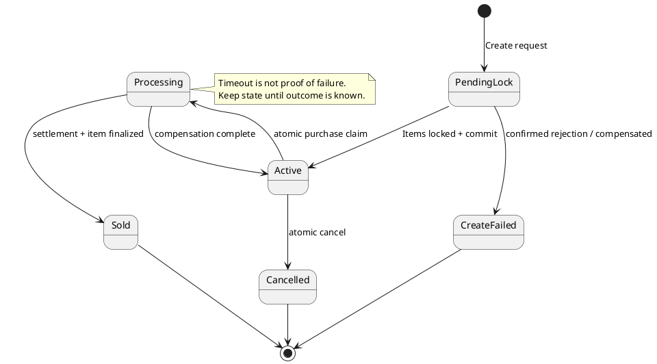
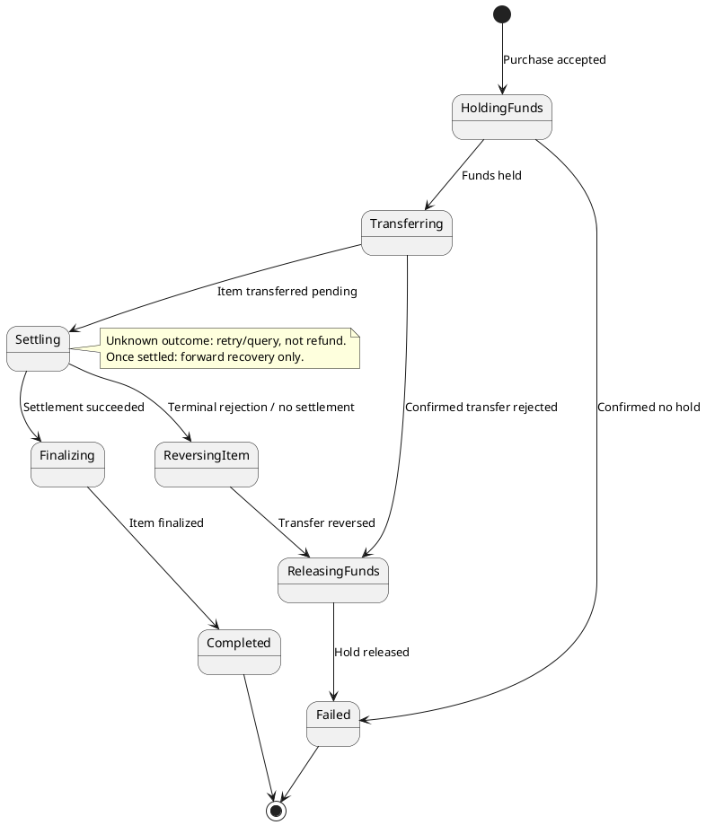

# Architectural Design Patterns
**MVP v0.1**

## 1. Pattern selection
| Pattern | Problem | Implementation | Trade-off |
|---|---|---|---|
| API Gateway | Client cần gọi nhiều service | YARP routing/auth; services kiểm quyền | Gateway là điểm điều phối truy cập, không phải nơi đặt nghiệp vụ |
| Database-per-Service | Coupling dữ liệu | 5 DB SQL logic + Mongo của Marketplace | Không join / ACID xuyên service |
| Saga Orchestration | Giao dịch tiền và đồ qua nhiều DB | Persisted state machine ở Marketplace; RabbitMQ commands/replies | Eventual consistency, cần compensation/recovery |
| CQRS | Luồng đọc lớn hơn ghi | SQL write, Mongo projection, cùng service | Dữ liệu read có thể trễ; chưa scale riêng query |
| Distributed Lock | Tranh mua Listing | Redis SET NX TTL + token | Lock có thể hết hạn; SQL guard là quyết định cuối |
| Transactional Outbox | DB commit nhưng publish lỗi | Business state + outbox commit atomically | Event phát muộn; có thể duplicate |
| Idempotent Consumer | Broker redelivery / callback trùng | Durable unique keys + state guards | At-least-once, không giả định exactly-once |
| Adapter | Định dạng payment / identity khác mô hình nội bộ | Wallet payment adapter; Auth Google adapter | Một provider trong MVP |
| Retry / error queue | Sự cố tạm thời | Bounded retry, error queue, trace + replay | Cần phân biệt lỗi nghiệp vụ và lỗi kỹ thuật |

Nguồn: Idea + Analyst BR/NFR, `a(1).txt` mục 5–6. Outbox, version guard, atomic claim và bước finalize là bổ sung đề xuất để tránh các failure window chưa được mô tả đầy đủ.

## 2. Saga orchestration
Marketplace lưu Trade/Saga state, không cập nhật WalletDb hoặc InventoryDb. Mỗi command có TradeId và correlation; mỗi consumer trả kết quả thành công hoặc từ chối nghiệp vụ. Tiền được giữ trước khi chuyển đồ; item ở PendingSettlement cho đến sau tất toán. Chỉ phát TradeCompleted khi item đã khả dụng và trạng thái cuối được commit.

- Trước settlement: nếu biết chắc bước lỗi chưa commit, bồi hoàn bước đã thực hiện. Nếu transfer đã commit nhưng settlement bị từ chối thật sự thì reverse item trước khi release hold.
- Sau settlement: không refund tự động; retry FinalizeItemTransfer và cập nhật Sold. Settlement thành công là điểm không quay lại trong MVP.
- Timeout / mất reply chưa có nghĩa là thất bại. Retry cùng operation key hoặc tra cứu trạng thái. Nếu vẫn không rõ, giữ Processing và đánh dấu cần đối soát; không mở lại hàng để bán.

## 3. State machine — Listing

## 4. State machine — Trade Saga
Các trạng thái biểu diễn happy path và lỗi nghiệp vụ xác định; lỗi kỹ thuật retry hoặc manual review trên trạng thái hiện tại. Failed chỉ khi không còn side effect chưa được bồi hoàn; Listing về Active cùng local commit cuối (trừ lỗi tạo listing).

## 5. Distributed lock
- Marketplace dùng cùng lock key cho purchase và cancel khi có thể, token ngẫu nhiên; acquire SET NX PX (10–30 giây theo a(1)); release compare-and-delete, không DEL mù.
- Claim Active → Processing (mua) hoặc Active → Cancelled (hủy) bằng SQL conditional update; chỉ request thắng được commit. Nếu Redis không khả dụng, từ chối an toàn/503 trong MVP, không bỏ qua kiểm tra SQL.
- Lock có thể giải phóng ngay sau claim bền vững; nếu chọn giữ TTL đến lúc kết thúc thì chỉ giải phóng token của chính request. Processing là bảo vệ xuyên Saga. Lock hết hạn không tự động Active.
- Một Redis instance không phải Redlock đa node. Không cam kết HA.

## 6. CQRS consistency
Command SQL là authoritative. Với mỗi thay đổi Listing, tăng version và gửi event gồm snapshot cần thiết cho Mongo. Projection apply if incoming version newer; giữ tombstone version cho Sold/Cancelled. Khi Processing hoặc Active trở lại có thể publish ListingProcessing/ListingReactivated để giảm hiển thị stale; dù chưa đồng bộ, mua vẫn kiểm tra SQL.

## 7. Payment reliability
Adapter tạo order với ID nội bộ, snapshot tỷ lệ quy đổi, số tiền VND và Gem. Callback đã verify mới chuyển Pending → Paid trong local transaction và credit ví. Trùng callback trả kết quả hợp lệ mà không cộng lần hai. Provider redirect không phải bằng chứng thanh toán. Unknown status có thể truy vấn provider để đối soát. Chỉ Sandbox, không cashout.

## 8. Cut line cho 11–12 ngày
Ưu tiên các failure guard ở luồng purchase/top-up. Nếu không kịp hoàn thiện recovery tự động, giữ giao dịch ở Processing + error queue/trace và ghi rõ giới hạn; không giả lập thành công hoặc coi việc trả 202 là giao dịch hoàn tất. Các cơ chế mở rộng như HA, distributed tracing hạ tầng riêng, full reconciliation dashboard không thuộc MVP.
