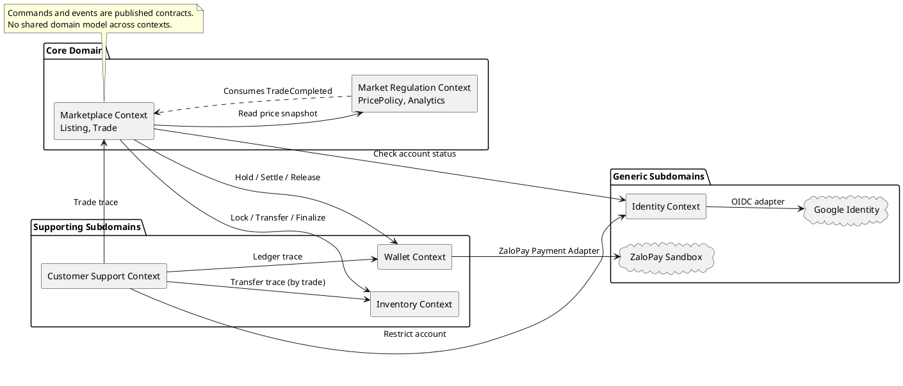
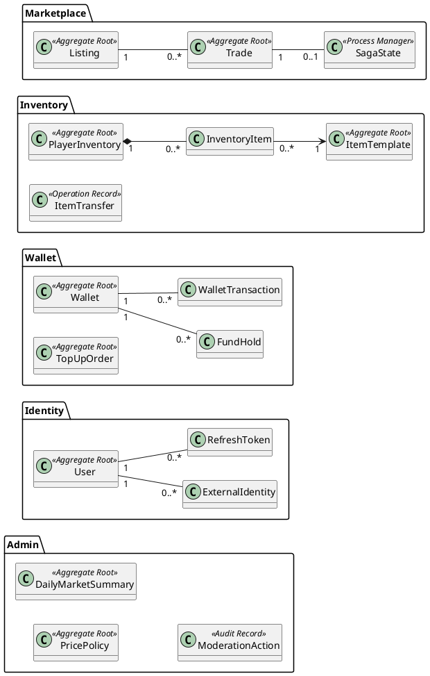

# Domain-Driven Design (DDD)
**Dự án:** In-game P2P Marketplace and Economy Management System — thiết kế MVP v0.1

## 1. Mục tiêu và phạm vi
Phân rã theo năng lực nghiệp vụ và quyền sở hữu dữ liệu thay vì tách service theo từng bảng CRUD. Giữ 7 business modules, đề xuất 6 bounded contexts và đóng gói vào 5 Microservices + 1 Gateway. CQRS Command/Query là hai mô hình trong Marketplace Context, không phải hai domain độc lập. GM và CS có mô hình nghiệp vụ khác nhau nhưng cùng Admin.API để giảm chi phí triển khai.

Nguồn ưu tiên: `a(1).txt` (mục 1–5); `SOA - Analyst(1).md` (BR-01–05, FR); `SOA - Live-Service Story-telling Visual Novel Game System _ Game Item Marketplace(1).md` (business idea). Thay đổi Google Sign-In + một payment sandbox là định hướng mới trong trao đổi của nhóm. Những quyết định dưới đây mang tính thiết kế đề xuất, chưa phải yêu cầu đã được giảng viên duyệt.

## 2. Ubiquitous Language
| Thuật ngữ | Ý nghĩa |
|---|---|
| Player / Buyer / Seller | Player là tài khoản; Buyer và Seller là vai trò theo giao dịch, không phải role JWT riêng |
| Gem / Gold | Chỉ Gem dùng ở Marketplace; Gold chỉ mô tả bối cảnh game, không hiện thực sổ cái Gold trong MVP |
| Item Template | Mẫu vật phẩm, tên, rarity, danh mục |
| Inventory Item | Vật phẩm cụ thể thuộc sở hữu Player |
| Listing | Tin đăng, giá niêm yết, số lượng, trạng thái |
| Trade | Một lần thực hiện mua; có ID và trạng thái xử lý độc lập với Listing |
| Fund Hold | Khoản Gem tạm giữ riêng theo TradeId |
| Settlement | Tất toán tiền buyer, seller và phí sàn trong một local transaction |
| Base / Reference Price | Giá khởi điểm / giá tham chiếu từ các giao dịch đã hoàn tất |
| Price Policy | Giá gốc và biên độ giá do GM quản lý |
| Trade Trace | Vết các bước xử lý, dùng cho tra soát |
| Compensation | Hành động nghiệp vụ đảo ngược bước đã thực hiện, không phải rollback xuyên DB |

## 3. Phân loại Subdomain
| Loại | Subdomain | Lý do |
|---|---|---|
| Core | Marketplace Trading | Niêm yết, hủy, mua, quy tắc giao dịch |
| Core | Market Regulation | Giá tham chiếu, biên độ, đo lường hoạt động kinh tế |
| Supporting | Wallet Management | Quản lý Gem và tất toán |
| Supporting | Inventory Management | Quyền sở hữu và khóa vật phẩm |
| Supporting | Customer Support | Tra soát và chế tài |
| Generic | Identity / Payment Integration | Xác thực và giao tiếp nhà cung cấp có tính tái sử dụng |

Payment Integration là subdomain generic được đóng gói trong Wallet Context ở MVP; Saga/CQRS/Redis Lock là giải pháp kỹ thuật, không phải subdomain.

## 4. Bounded Contexts
| Context | Service | Mô hình và trách nhiệm |
|---|---|---|
| Identity | Auth.API | User, ExternalIdentity, RefreshToken, role, account status |
| Wallet | Wallet.API | Wallet, FundHold, TopUpOrder, Ledger, thanh toán |
| Inventory | Inventory.API | ItemTemplate, PlayerInventory, InventoryItem, ItemTransfer |
| Marketplace | Marketplace.API | Listing, Trade, SagaState, MarketplaceCatalog projection |
| Market Regulation | Admin.API | PricePolicy, Trade analytics, DailyMarketSummary |
| Customer Support | Admin.API | ModerationAction, API tổng hợp vết giao dịch |

## 5. Context Map
Các context trao đổi qua published REST/message contracts; ID từ context bên ngoài là tham chiếu logic, không phải FK. Auth/Wallet dùng adapter để cách ly định dạng Google và nhà cung cấp thanh toán. Marketplace điều phối nhưng không sở hữu tiền hoặc kho. Admin sở hữu chính sách giá; Marketplace chỉ sử dụng snapshot đọc.

## 6. Domain Model và Aggregate Roots
| Aggregate / đối tượng | Invariant chính |
|---|---|
| User | Provider + provider subject là duy nhất; role và trạng thái do Auth quản lý |
| Wallet | Total >= Hold >= 0; Available = Total − Hold; một hold cho mỗi TradeId |
| TopUpOrder | Mỗi đơn hợp lệ chỉ được cộng Gem một lần; đối chiếu số tiền và đơn nội bộ |
| PlayerInventory | Không vượt capacity; chỉ khóa vật phẩm thuộc sở hữu; không dùng/bán item đã khóa |
| ItemTemplate | ID ổn định, thuộc tính dùng chung; giá gốc thuộc Admin |
| Listing | Chỉ seller được hủy; chuyển Active → Processing hoặc Cancelled nguyên tử; tối đa một giao dịch thành công |
| Trade | Buyer khác Seller; snapshot giá/phí bất biến; trạng thái kết thúc rõ ràng |
| PricePolicy | BasePrice > 0; biên độ hợp lệ; có version |
| DailyMarketSummary | Tổng hợp theo ngày và item template; không cộng trùng trade |
| ModerationAction | Ai thực hiện, đối tượng, lý do, thời gian, kết quả |

SagaState là process manager kỹ thuật, không phải domain aggregate; ledger, trace và transfer record là mô hình lưu vết. Hai ví trong cùng WalletDb và hai kho trong InventoryDb được cập nhật bằng local transaction để bảo toàn dữ liệu. Không ép mọi nghiệp vụ vào một aggregate hoặc một transaction xuyên service.

## 7. Chính sách nghiệp vụ đề xuất cần nhóm xác nhận
| Quyết định | Mặc định đề xuất |
|---|---|
| Mua một phần | Không; mua toàn bộ số lượng một Listing; đơn giản nhất là seed mỗi item như một instance, quantity = 1 |
| Đơn vị Gem | Số nguyên không âm (long); tính phí bằng số nguyên an toàn |
| Phí sàn | 5% minh họa; snapshot tại lúc chấp nhận Trade, làm tròn xuống; chưa được nhóm chốt |
| Biên độ | 20% mặc định, GM sửa trên policy; giá nguyên trong [ceil(ref × (1−α)), floor(ref × (1+α))], tối thiểu 1 Gem |
| Giá tham chiếu | Trung bình các đơn vị vật phẩm đã giao dịch trong ngày (sum gross / sum quantity), fallback giá ngày gần nhất có giao dịch hoặc BasePrice; đơn giản hóa rolling window. Không khẳng định đây là công thức gốc |
| Chốt giá | Kiểm tra tại đăng bán; giá Listing cũ không bị sửa tự động khi GM đổi policy |
| Tài khoản bị hạn chế | Chặn lệnh mua/đăng bán mới; cho phép hủy niêm yết nếu chỉ TradeRestricted; Banned không truy cập; trade đã chấp nhận được xử lý đến trạng thái cuối |
| Capacity | Số slot hữu hạn; giữ slot cần phục hồi cho seller khi vật phẩm chuyển tạm |

Các mặc định này cần duyệt trước khi freeze API Contracts; giới hạn 1 listing bán toàn bộ không loại bỏ trường quantity nếu nhóm cần mở rộng.
