# System Behavioral Design — Sequence Diagrams
**MVP v0.1**

## 1. Notation and common assumptions
Diagrams omit Gateway in internal traffic and simplify broker dispatcher/ack flow where needed. Every public request goes through Gateway with auth policy; outbound messages representing SQL commits are published from the outbox dispatcher, not directly by SQL. For readability, a few event sends show service → MQ rather than drawing outbox per event. All mutation operations are idempotent and correlate ListingId/TradeId/TopUpId as appropriate. State diagrams are in Design-Patterns.md. No final endpoint names or JSON schemas are frozen here.

Priority P0 = indispensable for trading; P1 = required by proposed integration / admin scope. Source: `a(1).txt` section 5, Analyst FR and state matrix; Google/Sandbox and explicit recovery handling are new design proposals.

## 2. Create Listing (P0)
Persist a PendingLock intent for recovery; final Active still occurs only after confirmed Inventory lock, preserving synchronous REST requirement. Confirmed failure unlocks; unknown outcome is resolved by retry/query. Duplicate create must return original operation result.

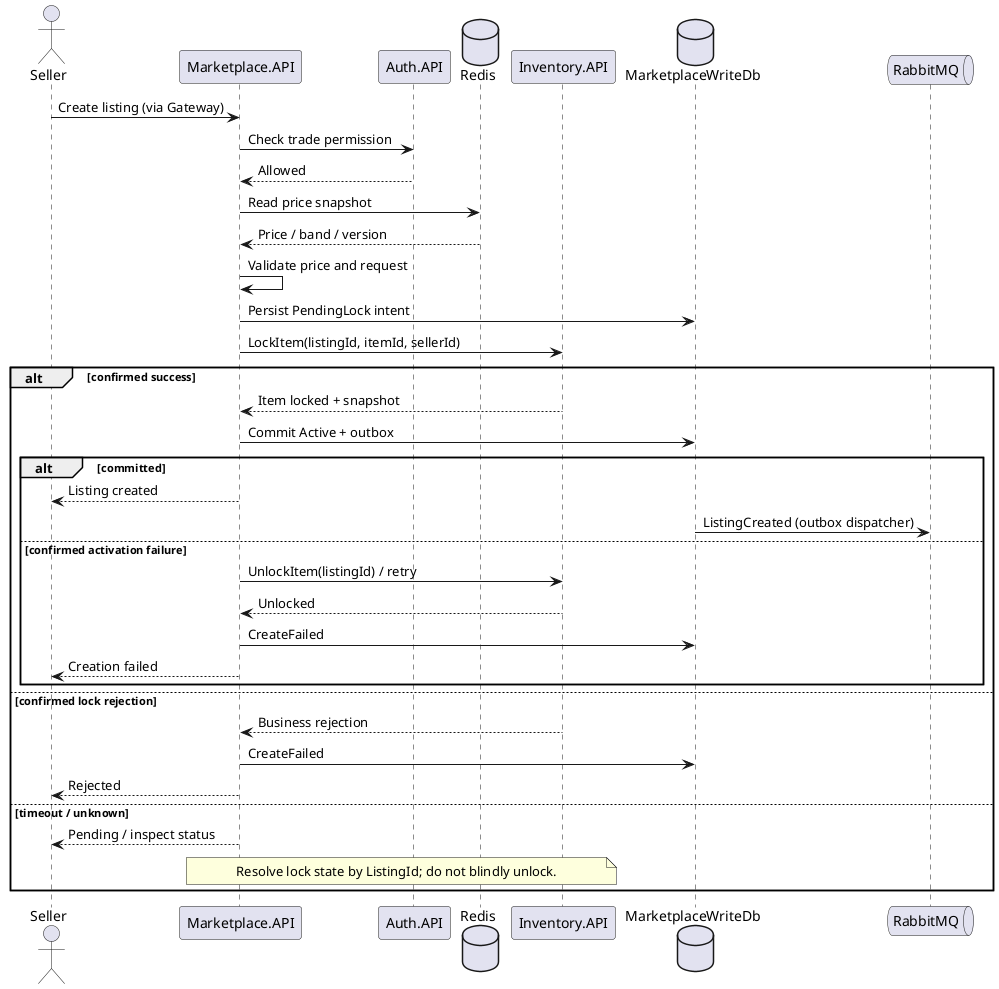

## 3. Cancel Listing (P0)
Cancellation changes SQL state and publishes event, Inventory unlock is asynchronous. A user may see item locked briefly. Retry failed consumers; do not show item available until confirmed.

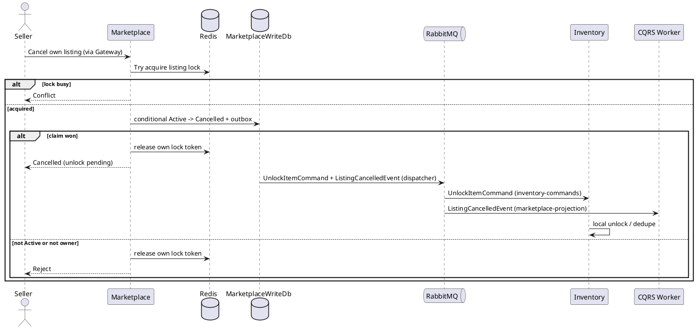

## 4. Direct Purchase — Happy Path (P0)
The buyer receives 202 only after durable acceptance. A Purchase may later fail if not enough Gem or capacity. Buyer polls trade status. Price and fee are determined by server snapshot; not trusted from request.

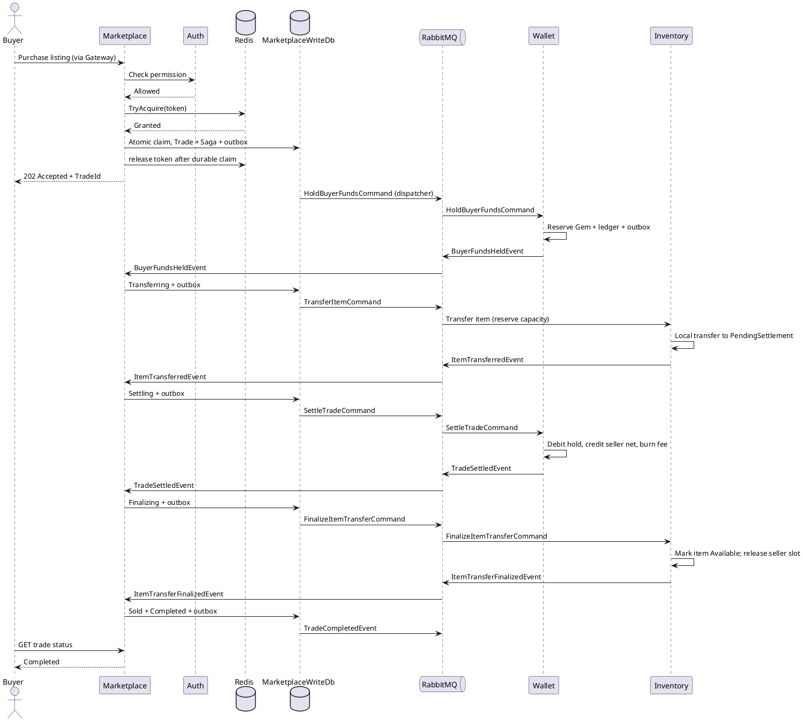

## 5. Saga Compensation (P0)
Two confirmed failure scenarios after holding funds. A rejection before hold succeeds simply fails trade and reactivates Listing. After successful settlement, only forward recovery is allowed. A timeout does not justify compensation.

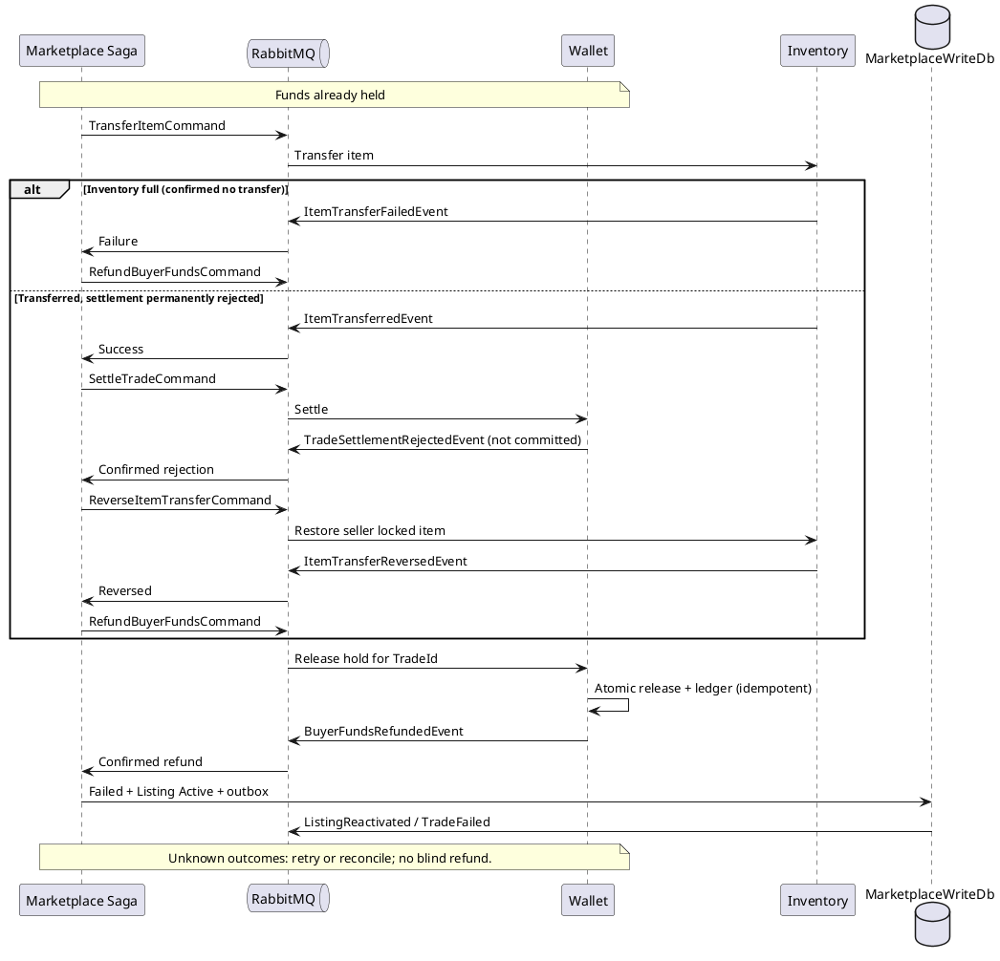

## 6. Concurrent purchase (P0)
Redis reduces contention. SQL conditional state guards ensure at most one successful claim even when lock expires; same SQL condition protects cancel vs purchase.

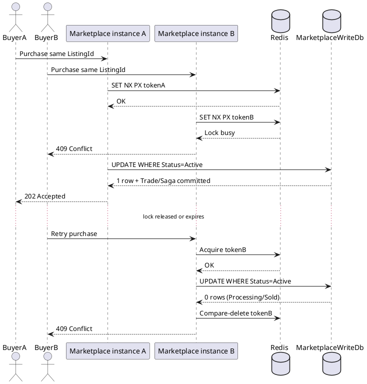

## 7. CQRS Synchronization (P0)
Version guard and tombstones protect against late/duplicated events. Reading Mongo is not authorization to purchase.

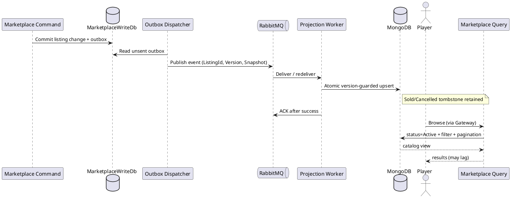

## 8. Top-up via ZaloPay Sandbox (P1)
ZaloPay Sandbox là provider đã chốt. Figure 22A bao gồm khởi tạo đơn nội bộ, gọi Create Order và thanh toán; Figure 22B mô tả callback, reconciliation và kiểm tra trạng thái. Hai sơ đồ dùng chung TopUpId và app_trans_id. Redirect không xác nhận thanh toán; callback/query phải đối soát và dùng chung local atomic idempotent settlement. Chi tiết payload và mã phản hồi xem `../03-Contracts/API-Contracts.txt` (WAL-04..06). Không có tiền thật.

### Figure 22A — Create Order & Payment

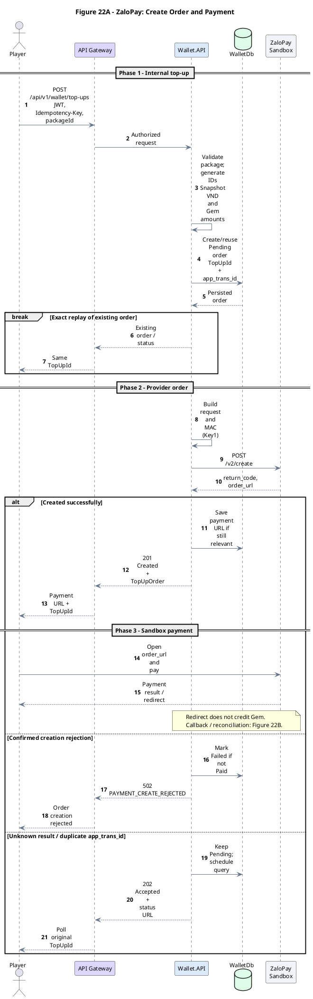

### Figure 22B — Callback & Reconciliation

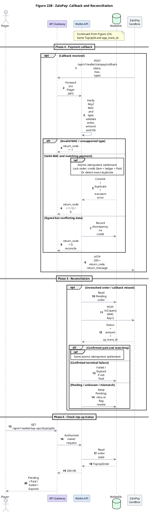

## 9. Google Sign-In (P1)
Proposed ID-token flow using a minimal browser login helper (not full UI); if team selects authorization-code flow, change diagram/contracts accordingly. Google subject is canonical external identity; local role only.

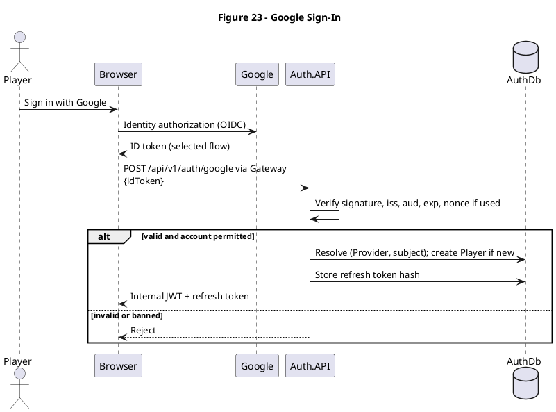

## 10. Market Analytics (P1)
Trade facts ensure reconstructable stats. For MVP after new fact insert, recompute affected item/day only, then update Redis atomically/versioned to avoid stale concurrent updates; can serialize by item/day. This is deliberate simplification of pure Redis incremental aggregation in Analyst. Daily snapshot includes reconciliation for late events. GM business statistics are separate from Grafana.

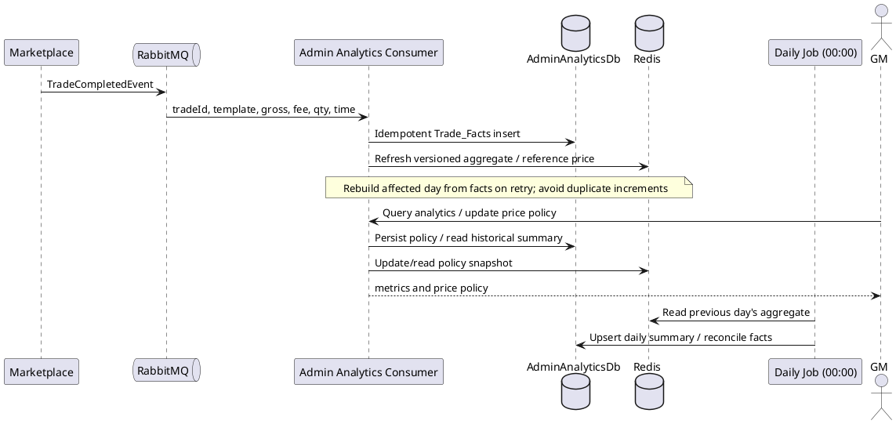

## 11. Customer Support (P1)
Admin uses authorized internal calls, never DB cross-query. Status restriction applies to new operations. Partial trace is marked rather than falsely reported complete.

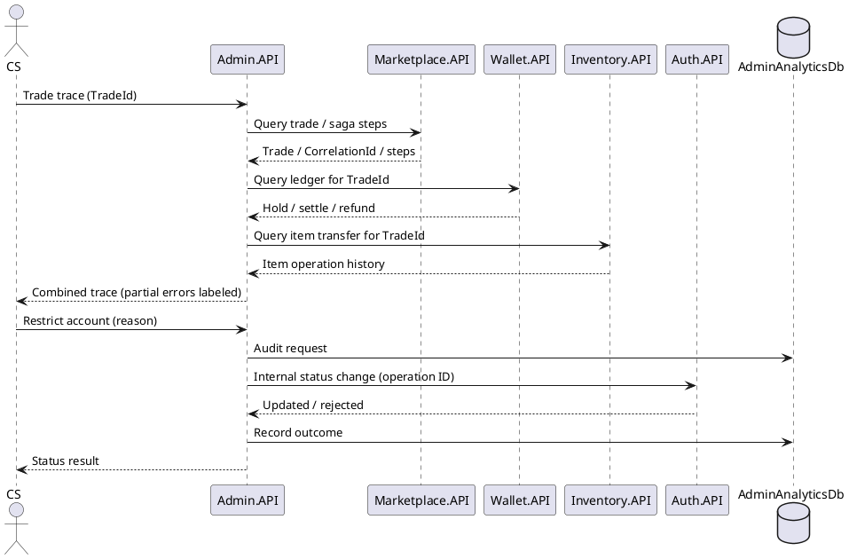

## 12. State/data example
Example only: buyer has 1,200 Gem total, 0 hold; item costs 1,000 Gem; fee 5% (not approved). Seller starts at 0 Gem. Single trade, no concurrent wallet operations in example.
| Step | Listing | Buyer Total / Hold / Available | Seller Gem | Item |
|---|---|---|---:|---|
| Listed | Active | 1200 / 0 / 1200 | 0 | Seller Locked |
| Claim | Processing | 1200 / 0 / 1200 | 0 | Seller Locked |
| Hold | Processing | 1200 / 1000 / 200 | 0 | Seller Locked |
| Transfer | Processing | 1200 / 1000 / 200 | 0 | Buyer PendingSettlement |
| Settle | Processing | 200 / 0 / 200 | 950 | Buyer PendingSettlement |
| Finalize | Sold | 200 / 0 / 200 | 950 | Buyer Available |
| Alternative: full inventory then refund | Active | 1200 / 0 / 1200 | 0 | Seller Locked |

## 13. Acceptance test matrix
| Scenario | Expected invariant |
|---|---|
| Duplicate callback | One top-up credit only |
| Duplicate purchase key | Same TradeId; no second hold |
| 100 buyers / one listing | At most one completed trade; losers conflict (if buyer winner valid) |
| Cancel vs purchase | Exactly one valid transition from Active |
| Insufficient funds | No hold/transfer, Listing reactivated |
| Inventory full | Hold released; seller item remains Locked |
| Duplicate settle event | One payout only |
| Lock TTL expires | Processing remains; second claim rejected |
| Broker/consumer temporarily unavailable | Durable state; resume or trace error; no blind refund |
| Mongo out-of-order | Old event cannot resurrect Sold/Cancelled |
| Banned/TradeRestricted | New purchase/listing denied |
| Daily job repeated | Same daily key upserted, no duplicate totals |
