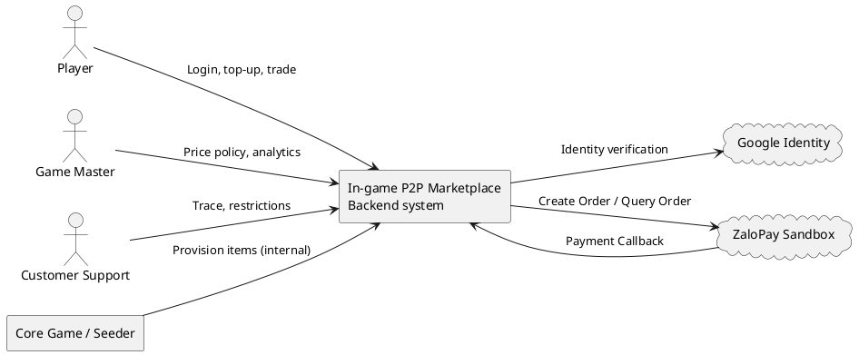
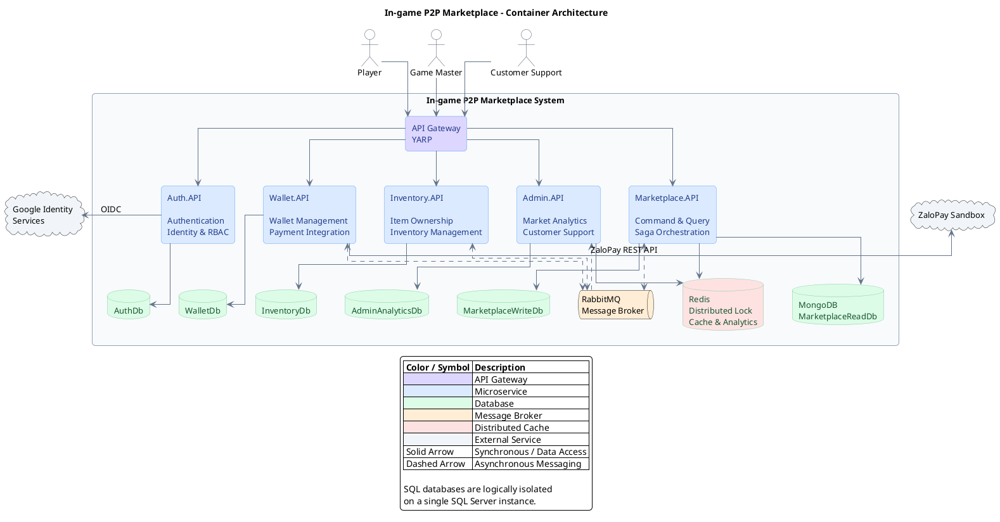
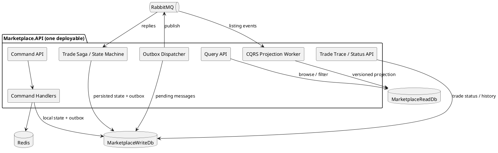
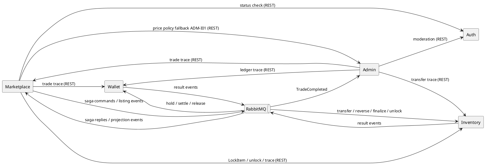

# System Architecture
**Dự án:** In-game P2P Marketplace — MVP v0.1

## 1. Architectural drivers
- Business: chỉ Gem, Direct Purchase, phí sàn, biên độ giá và quyền sở hữu tài sản.
- SOA: service contract rõ ràng, loose coupling, khả năng phối hợp qua REST và messaging, tích hợp bên thứ ba.
- NFR: local ACID, eventual consistency, idempotency, chống overselling/double spending, khả năng quan sát và triển khai đồng nhất.
- Constraint: 3 người/11–12 ngày; không frontend hoàn chỉnh; một SQL Server container, 5 database logic; 5 service + YARP; 1 payment sandbox, Google login.

Nguồn: `a(1).txt` mục 3–6; Analyst FR/NFR; Idea mục công nghệ. Google và Sandbox là bổ sung đã thảo luận, chưa xác nhận credentials hoặc yêu cầu chính thức của giảng viên.

## 2. System context

## 3. Service decomposition và trách nhiệm
| Service | Modules / FR gốc | Trách nhiệm và public capabilities | Nội bộ |
|---|---|---|---|
| Auth.API | 1; AUTH-01,02,04 | Login, refresh, logout, Google Sign-In | Kiểm tra trạng thái, đổi status/role có quyền |
| Wallet.API | 2; WAL-01–06 | Balance, top-up, ledger, provider callback | Hold, settle, release; đối soát top-up |
| Inventory.API | 3; INV-01–05 | Inventory của mình | Seed, lock/unlock, transfer/reverse/finalize |
| Marketplace.API | 4+5; MKT-01–05, QRY-01–04 | Listing, cancel, purchase, browse/filter, my listings, trade status/history | Saga orchestration, projection, trace |
| Admin.API | 6+7; GM-01–04, CS-01–02 | Stats, price policy, trace, restrict account | Analytics consumer, daily job, aggregate internal REST |
| Gateway | Cross-cutting | Một điểm truy cập; routing; JWT ở route được bảo vệ | Không business logic, không business DB |

29 FR gốc còn lại sau loại AUTH-03, GM-05, GM-06. Google login và Sandbox thay đổi chi tiết AUTH-01/WAL-02–03; các kỹ thuật bổ sung không tự động là FR độc lập. Với API CRUD nội bộ, mỗi service kiểm tra quyền chứ không chỉ dựa vào gateway.

## 4. Container architecture

### 4.1. Thành phần chung
| Công nghệ | Vai trò |
|---|---|
| ASP.NET Core / C# | REST handlers, application/domain/infrastructure |
| YARP | Reverse proxy, routing policy |
| RabbitMQ + MassTransit | Command/event transport, consumer và saga state machine |
| SQL Server | Authoritative state, local transaction, outbox/inbox |
| MongoDB | Denormalized catalog, không dùng để phê duyệt mua |
| Redis | Short-lived listing locks, versioned price cache, analytics |
| OpenAPI/Swagger | REST contract; message contracts tách riêng (giai đoạn tiếp theo) |
| Docker Compose / ngrok | Local demo / public HTTPS gateway có kiểm soát |
| Prometheus / Grafana | Thu thập métrics / dashboard |

## 5. Marketplace internal components
Command và Query cùng deployable để tiết kiệm RAM; không được tuyên bố có thể scale riêng Query ở MVP. Query browse không chạm MarketplaceWriteDb; trade status/history đọc SQL của chính Marketplace để cung cấp kết quả chuẩn.

## 6. Communication design
| Use case | Producer → Consumer | Phương thức |
|---|---|---|
| Protected request | Client → Gateway → Service | REST + JWT |
| Google login | Client/Auth ↔ Google | OIDC; verify token/code theo flow chọn |
| Top-up | Wallet ↔ provider | ZaloPay REST Create/Query + signed callback |
| Create listing | Marketplace → Inventory | REST lock; idempotent theo ListingId |
| Cancel listing | Marketplace → Inventory / Projection | RabbitMQ `UnlockItemCommand` (tới Inventory) + `ListingCancelledEvent` (tới Projection) |
| Purchase | Marketplace → Wallet/Inventory | RabbitMQ saga commands + result events |
| Market read sync | Marketplace → CQRS consumer | RabbitMQ versioned events |
| Analytics | Marketplace → Admin | RabbitMQ TradeCompletedEvent |
| Price lookup | Marketplace → Redis / Admin | Đọc `price:policy:{templateId}` trên Redis; cache miss gọi fallback `ADM-I01` (internal REST) |
| Restrict/trace | Admin → Auth/Marketplace/Wallet/Inventory | Internal REST; không đọc chéo DB |
| Explicit account status | Marketplace → Auth | Internal REST trước khi chấp nhận lệnh mua/đăng bán |

## 7. Security boundary
- JWT do Auth phát hành; role Player/GM/CS nội bộ; Buyer/Seller không phải role riêng. Service xác minh issuer, audience, expiry, chữ ký; internal REST dùng service credential, không expose ở gateway.
- Google callback/login public theo flow; xác minh issuer/audience/expiry, subject ổn định, nonce/state nếu flow yêu cầu; không gán quyền GM/CS từ Google claims. Không tự liên kết tài khoản theo email không xác minh.
- ZaloPay callback public có kiểm tra chữ ký, order ID, amount, trạng thái provider; return URL chỉ hiển thị kết quả, không cộng Gem. Không log token/secret.
- API Gateway chỉ route public allowlist; seeder, command nội bộ, broker/DB/metrics không expose qua ngrok. Hạn chế truy cập Swagger public nếu cần; ngrok chỉ để demo.
- Auth sở hữu trạng thái ban; kiểm tra tại thời điểm nhận lệnh, không hủy ngang Saga đã bắt đầu.

## 8. Traceability và các giới hạn
| Driver | Giải pháp | Bằng chứng demo |
|---|---|---|
| FR-MKT-04 / NFR-CONC | Redis lock + conditional SQL update | 100 request: tối đa 1 completed trade |
| FR-MKT-05 / NFR-CONS | Saga + local transactions | Success / full inventory + release hold |
| FR-QRY-01 / NFR-PERF | CQRS | SQL write → MongoDB projection |
| FR-WAL-03 / NFR-CONS-04 | signed callback, unique provider transaction | Duplicate callback không cộng trùng |
| FR-GM-01–04 | Consumer + cache + daily job | Summary + change policy |
| NFR-SCAL-02 / OBS-01 | Compose + metrics | Run, dashboard, health |

Không cam kết throughput hoặc latency trước khi benchmark; đo query p95, sync lag và số giao dịch completed. Một broker/SQL/Redis instance không phải HA; chỉ chứng minh retry/recovery khi service dừng.
